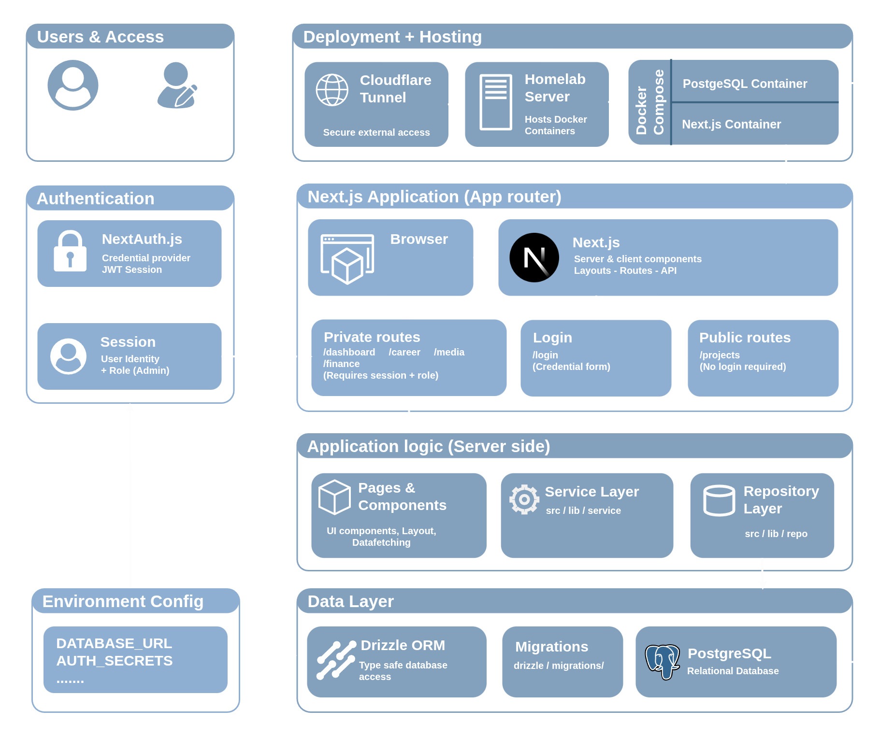

# Personal Site

A personal portfolio and private workspace built with Next.js, React, TypeScript, and Tailwind CSS. The project combines a public-facing portfolio with tools for managing career development, resources, projects, and other personal information.

**Live site:** [olivernorrie.com](https://olivernorrie.com)

**Repository:** [GitHub](https://github.com/GrayHound85/personal-site)

## What is Already Built

### Public Portfolio
- Personal profile and introduction.
- Project showcase with individual project pages.
- Experience and achievements sections.
- Links to GitHub, LinkedIn, and LeetCode.
- Responsive layouts for desktop, tablet, and mobile.

### Resource Library
- A structured library for useful learning resources.
- Support for organising resources into categories and pages.
- A foundation for collecting programming, data structures, algorithms, and interview preparation material.

### Personal Workspace
The application also contains private sections intended to support personal organisation and career development.

| Section | Purpose |
| --- | --- |
| Dashboard | Central starting point for private tools |
| Career | Career development and internship tracking |
| Finance | Personal finance tools |
| Media | A foundation for a personal media library |
| Notes | Personal notes and knowledge management |
| Projects | Project management and documentation |

Some areas are still under development as the application grows.

## Architecture

The application is built around Next.js App Router, with server-side functionality for data access and authentication. PostgreSQL provides persistent storage, accessed through Drizzle ORM.



The architecture diagram above illustrates the application's structure and how its components interact.

## Technology Stack

| Technology | Purpose |
| --- | --- |
| Next.js | Application framework and routing |
| React | Component-based user interface |
| TypeScript | Type safety and maintainability |
| Tailwind CSS | Responsive styling and design system |
| PostgreSQL | Relational database |
| Drizzle ORM | Type-safe database queries and schema management |
| NextAuth.js | Authentication |
| Docker | Containerised deployment |
| GitHub Actions | Automated build and deployment workflow |
| GitHub Container Registry | Storage and distribution of Docker images |
| Cloudflare Tunnel | Remote access without directly exposing server ports |

## Skills Developed

This project is an opportunity to develop practical full-stack engineering skills while building something that I can continue to use.

- **Frontend development:** Building reusable React components and learning how layouts behave across different screen sizes.
- **Full-stack development:** Connecting the frontend to server-side logic, authentication, and a relational database.
- **Database design:** Modelling application data and accessing it through Drizzle ORM.
- **Authentication and authorisation:** Separating public content from private functionality.
- **Deployment:** Building Docker images and running the application on a self-hosted Ubuntu server.
- **CI/CD:** Using GitHub Actions to automate image builds and publish deployable versions.
- **Infrastructure:** Managing containers, environment variables, networking, and remote access.
- **Software architecture:** Organising a growing application into maintainable routes, components, and server-side modules.

## Where the Project Is Going

The long-term goal is to make the site a central hub for both my personal and technical projects.

Potential areas of development include:

- A more complete internship and application tracker, including application opening dates.
- A richer resource library with notes, links, books, and videos.
- Improved project documentation and progress tracking.
- Additional personal productivity and finance tools.
- A personal media library hosted on the same home server.
- A central interface for managing selected self-hosted services and containers.

These features will be developed incrementally as the underlying application and infrastructure mature.

## Project Structure

The application uses the Next.js App Router. Routes and supporting code are organised into separate directories according to their responsibilities.

```text
app/
├── actions/
├── career/
├── dashboard/
├── finance/
├── login/
├── media/
├── notes/
└── projects/
```

The exact contents of each directory will evolve as new functionality is added.

## Running Locally

### Prerequisites

- Node.js compatible with the project configuration.
- npm.
- A PostgreSQL database.
- Environment variables configured for authentication and database access.

### Setup

Clone the repository:

```bash
git clone https://github.com/GrayHound85/personal-site.git
cd personal-site
```

Install dependencies:

```bash
npm install
```

Configure the required environment variables in a local `.env` file. These include the database connection string and authentication configuration, such as `DATABASE_URL`, `AUTH_SECRET`, and `AUTH_PASSWORD`, as required by the current implementation.

Start the development server:

```bash
npm run dev
```

Open [http://localhost:3000](http://localhost:3000) in your browser.

Available scripts can be checked in `package.json`.

## Deployment

The application is deployed using Docker on a self-hosted Ubuntu server.

The deployment workflow is designed to keep the application container separate from the persistent PostgreSQL service. Docker Compose is used to manage the services, while GitHub Actions builds and publishes application images to GitHub Container Registry.

The general deployment process is:

1. Changes are committed and merged into the deployment branch.
2. GitHub Actions builds the application image.
3. The image is published to GitHub Container Registry.
4. The server pulls the updated image.
5. Docker Compose recreates the application container using the new image.

Cloudflare Tunnel provides remote access to selected services without requiring their ports to be directly exposed to the internet.

## Security Considerations

- Secrets and credentials are stored in environment variables rather than committed to the repository.
- Private application areas require authentication.
- Database access is handled server-side.
- Docker containers separate the application from the host environment.
- Remote access is configured through Cloudflare Tunnel.

Authentication and authorisation remain important areas to review as more private features are introduced.

## Links

- **Website:** [olivernorrie.com](https://olivernorrie.com)
- **Source code:** [GitHub repository](https://github.com/GrayHound85/personal-site)