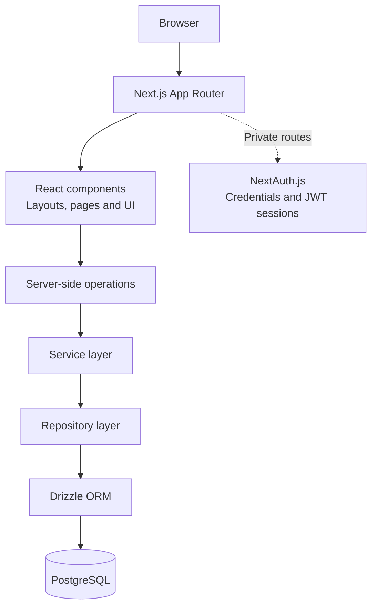

# Oliver Norrie | Personal Site

A self-hosted portfolio and full-stack web application built to showcase my work and provide a foundation for personal learning and productivity tools.

**Live site:** [olivernorrie.com](https://olivernorrie.com) · **Source code:** [GitHub](https://github.com/GrayHound85/personal-site)

---

## Overview

This project started as a personal portfolio and is evolving into a broader platform: a public space for presenting projects and technical work, alongside a private workspace for tools I build for myself.

I am using it to develop practical experience across the full software lifecycle—from designing reusable React components and modelling relational data to implementing authentication, containerising the application, and deploying it on my own homelab.

### Highlights

- **Full-stack TypeScript application** built with Next.js App Router and React.
- **Data-backed resource library** using PostgreSQL and Drizzle ORM, with separate service and repository layers.
- **Authentication and access control** using NextAuth.js credentials authentication and JWT-based sessions.
- **Responsive interface** built with Tailwind CSS 4 and reusable layout and UI components.
- **Self-hosted deployment** using Docker and Docker Compose, with a GitHub Actions / GitHub Container Registry workflow and Cloudflare Tunnel.
- **Designed to grow incrementally**, with clear boundaries between public portfolio pages and private workspace features.

## Application architecture

The diagram below shows the main application boundaries and how requests flow from the browser through the Next.js application to persistent data.


*Architecture diagram: Next.js App Router, authentication, application layers, PostgreSQL, and deployment components.*

> The image path above is relative to the repository root. GitHub displays the diagram when the image is committed at `public/projects/personal-site_architecture.png`.

### Architecture at a glance



The application uses server-side logic for data operations, with repository and service layers separating database access from application behaviour. Not every route uses every layer; the diagram represents the main architectural pattern.

## Technology stack

| Technology | How it is used |
|---|---|
| **Next.js App Router** | Routing, server-rendered pages, and server-side application features |
| **React + TypeScript** | Reusable UI components and typed application code |
| **Tailwind CSS 4** | Responsive styling and shared design conventions |
| **PostgreSQL** | Relational data storage |
| **Drizzle ORM** | Typed database queries and schema management |
| **NextAuth.js** | Credentials-based authentication and JWT session handling |
| **Docker + Compose** | Containerised application and database services |
| **GitHub Actions + GHCR** | Automated image build and container image distribution |
| **Cloudflare Tunnel** | Configured remote access to the self-hosted deployment |

## Features and current status

I aim to be clear about what is implemented and what is still being developed.

| Feature area | Current status |
|---|---|
| Public portfolio and profile | Implemented |
| Public projects and project write-ups | Implemented |
| Administrator login and private workspace foundation | Implemented |
| PostgreSQL integration and Drizzle migrations | Implemented |
| Data-backed learning resource library | Core workflow implemented |
| Dashboard and workspace navigation | Foundation in place |
| Career and study tools | In progress; some routes are scaffolds |
| Media and finance areas | Early foundations; not complete workflows |
| Additional interactive projects | Planned |

## Engineering decisions

### Separation of concerns

The resource library demonstrates the separation between UI, service logic, repository queries, and persistence:

- **UI and routes** present information and collect user input.
- **Service layer** coordinates application operations.
- **Repository layer** encapsulates database access.
- **Drizzle and PostgreSQL** provide typed queries and persistent storage.

This structure makes responsibilities easier to understand and gives future features a pattern to follow.

### Public and private boundaries

The public portfolio is designed to be accessible without signing in, while private tools require an authenticated session and appropriate authorisation. Access checks for sensitive operations belong on the server rather than relying on whether a navigation link is visible.

### Self-hosted deployment

I wanted to understand more than application code, so the project also includes a containerised deployment path. GitHub Actions builds and publishes the configured application image to GitHub Container Registry; Docker Compose runs the application and database on my homelab. Cloudflare Tunnel provides the configured remote access path.

## Repository structure

```text
.
├── src/
│   ├── app/                 # App Router pages, layouts and API routes
│   ├── components/
│   │   ├── layout/          # Shared layouts
│   │   ├── sections/        # Page-specific sections
│   │   ├── ui/              # Reusable interface components
│   │   └── icons/           # Icon components
│   ├── config/              # Project and application configuration
│   ├── db/                  # Database connection and schema
│   ├── lib/
│   │   ├── repo/            # Data-access repositories
│   │   └── service/         # Application logic
│   └── auth.ts              # Authentication configuration
├── drizzle/
│   └── migrations/          # Versioned database migrations
├── scripts/                 # Operational scripts, including migrations
├── auth.config.ts           # Shared authentication configuration
├── drizzle.config.ts        # Drizzle configuration
├── Dockerfile               # Application container build
└── compose.yaml             # Container service definitions
```

This is a high-level guide; consult the repository for the complete current file tree.

## Running locally

### Prerequisites

- Node.js compatible with the version required by the project.
- npm.
- PostgreSQL, either installed locally or run through Docker Compose.

### 1. Clone and install

```bash
git clone https://github.com/GrayHound85/personal-site.git
cd personal-site
npm install
```

### 2. Configure environment variables

Create a `.env` file in the project root. The application uses the following configuration:

| Variable | Purpose |
|---|---|
| `DATABASE_URL` | PostgreSQL connection string |
| `AUTH_PASSWORD` | Password for the configured administrator login |
| `AUTH_SECRET` | Secret used by authentication/session configuration |
| `POSTGRES_USER` | Database container user |
| `POSTGRES_PASSWORD` | Database container password |
| `POSTGRES_DB` | Database name |

Use unique local credentials and never commit `.env` or real secrets. The database hostname in `DATABASE_URL` depends on where the application runs: a Compose service name is commonly used between containers, while a host-run development server may use a local port mapping.

### 3. Start the database and apply migrations

Review `compose.yaml` to confirm the services and ports before starting containers:

```bash
docker compose up -d
```

The repository includes Drizzle schema and migration files, plus `scripts/migrate.mjs`. Check `package.json` for the configured migration script and available commands:

```bash
npm run
```

Apply migrations to your configured database before running features that depend on the schema.

### 4. Run the development server

```bash
npm run dev
```

Then visit [http://localhost:3000](http://localhost:3000).

For a production build, run:

```bash
npm run build
```

Refer to `package.json` for the exact scripts available in the current branch.

## Deployment

The production deployment is designed around a self-hosted Ubuntu server.

1. A configured GitHub Actions workflow builds the application image.
2. The workflow publishes the image to GitHub Container Registry.
3. The homelab pulls the updated image.
4. Docker Compose runs the application and PostgreSQL services.
5. Cloudflare Tunnel provides the configured remote access route.

After a successful image publish, run the following from the server directory containing the deployment Compose file:

```bash
docker compose pull
docker compose up -d
docker compose ps
docker compose logs -f app
```

Check the Compose file for the actual service names and image tags. Routine updates should not require deleting database volumes.

## Security considerations

- Keep authentication secrets and database credentials out of version control.
- Protect private routes and sensitive server operations with server-side authorisation.
- Validate input before writing to the database.
- Avoid sending secrets or private data to client-side code.
- Back up important data before database migrations or maintenance.

The project currently uses a credentials-based administrator model; planned workspace sections should not be taken as evidence that every feature is complete.

## What I am learning

This project is a practical way to build experience in:

- Full-stack feature development, from UI to persistent data.
- Relational data modelling and database migrations.
- Component design and responsive interfaces.
- Authentication, sessions, and server-side access control.
- Application architecture and separation of concerns.
- Docker-based deployment, CI image publishing, and self-hosted operations.
- Delivering a larger project incrementally while communicating implementation status accurately.

## Roadmap

- Expand career and study tools for learning and professional development.
- Build out the personal media workspace.
- Develop finance and personal tracking tools.
- Host more interactive projects within the public portfolio.
- Improve the dashboard as complete workflows are added.

These are future directions, not completed features.

---

**Built by Oliver Norrie** · [Portfolio](https://olivernorrie.com) · [GitHub](https://github.com/GrayHound85)
